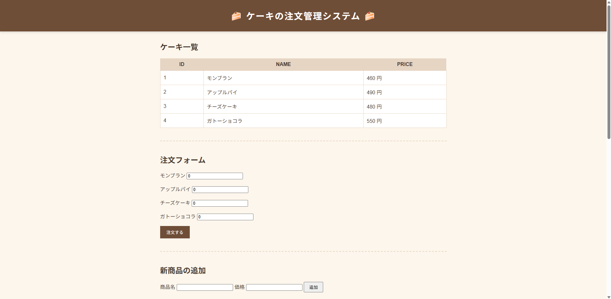
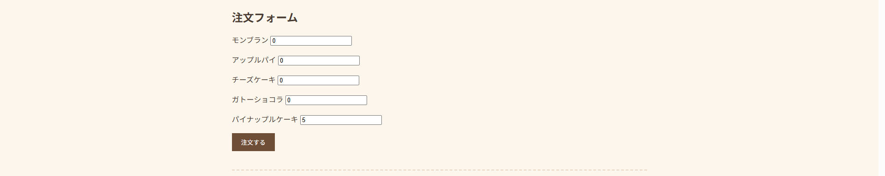
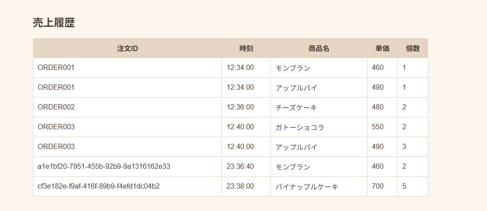
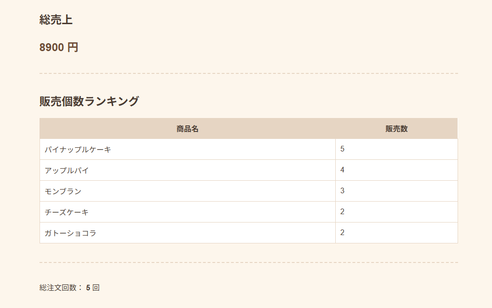

# ケーキ注文管理システム

Spring BootとH2 Databaseを使用して開発した、シンプルなケーキ注文管理Webアプリケーションです。

商品の注文、商品登録、売上履歴・販売数の集計を一つの画面から操作できます。

## スクリーンショット

### メイン画面
商品一覧、注文フォーム、新商品の追加機能を一つの画面から操作できます。



### 新商品の追加
商品名と価格を入力して、新しい商品を登録できます。  
例として「パイナップルケーキ」を追加しています。


### 追加した商品の注文
新しく登録した商品も注文フォームに反映され、他の商品と同様に数量を指定して注文できます。



### 売上履歴
注文ごとに発行された注文ID、時刻、商品名、単価、個数を一覧で確認できます。



### 売上集計
総売上、商品別の販売個数ランキング、総注文回数を確認できます。



## 主な機能

- 商品一覧の表示
- 商品数量を指定した注文
- 新商品の登録
- 売上履歴の表示
- 総売上金額の集計
- 商品別販売数の集計
- 販売数ランキングの表示
- 総注文回数の表示

## 使用技術

- Java
- Spring Boot
- Spring JDBC
- Thymeleaf
- H2 Database
- SQL
- HTML
- CSS
- Maven

## データベース

以下の3テーブルを使用しています。

- `cake` - 商品情報
- `o_time` - 注文情報
- `o_qtt` - 注文明細

注文ごとにUUID形式の注文IDを発行し、注文情報と商品ごとの購入数量を関連付けて保存します。

## 集計処理

売上履歴や販売数の集計にはSQLを使用しています。

商品別の販売数集計では `LEFT JOIN` と `COALESCE` を使用し、一度も注文されていない商品についても販売数を `0` として表示します。

## 起動方法

### 必要環境

- Java 17以上

### Windows / PowerShell

```powershell
.\mvnw.cmd spring-boot:run
```

起動後、以下のURLへアクセスします。

```text
http://localhost:8080/
```

## データベースについて

H2のインメモリデータベースを使用しています。

アプリケーション起動時にテーブルと初期データが作成され、アプリケーションを終了すると実行中のデータは破棄されます。

## プロジェクト構成

```text
src/main/java
└─ com.example.demo
   ├─ CakeShop.java
   └─ CakeDao.java

src/main/resources
├─ templates
│  └─ cakeshop.html
├─ application.properties
├─ schema.sql
└─ data.sql
```
